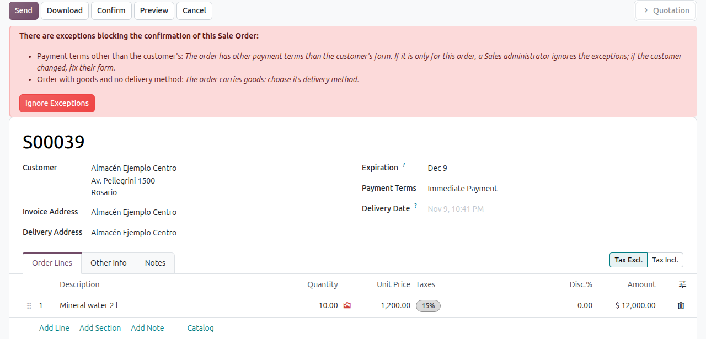

1. Confirm the order as usual.
2. When it is stopped, the order shows each exception with what to fix: fix it and confirm
   again.
3. If the difference is right for this order only, a Sales administrator confirms it with
   "Ignore Exceptions". A blocking rule, like a quantity with decimals, is never ignored:
   the line is fixed.
4. On an expired quotation, "Update Prices" brings today's prices before confirming.

